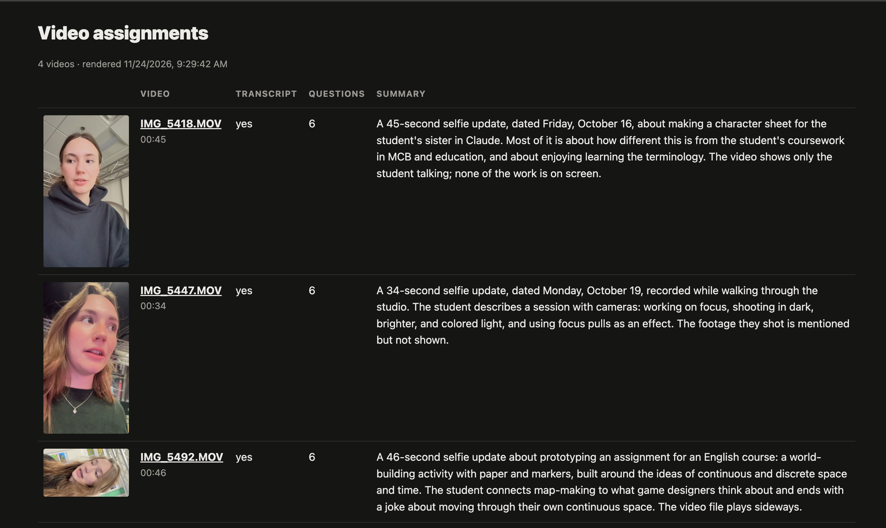
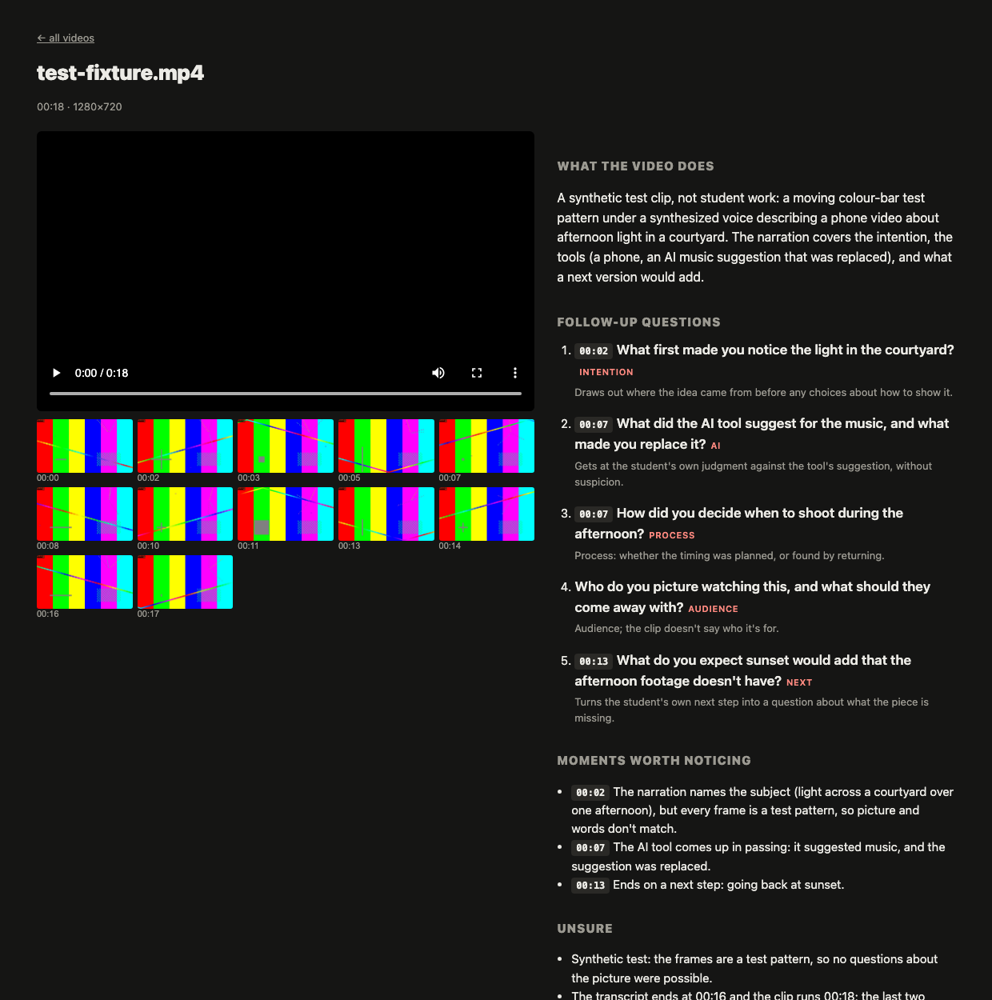

# video-assignment-tools

Tools for reading students' video assignments and drafting follow-up questions to ask each student. Public (since November 24, 2026; the code and docs only, never student work), created November 24, 2026 as mkuzmick (`ll-26-27/video-assignment-tools`) during the Learning Lab's week 12, and nested in `ll-week-12` at `apps/video-assignment-tools/`.

The first tool is a skill, **`video-assignment-parsing`**:

1. it transcribes each video through HUIT (Harvard's OpenAI Direct gateway, `whisper-1`) and pulls still frames with ffmpeg, up to 8 videos at a time (`--jobs`);
2. Claude reads the transcript and frames and writes timestamped follow-up questions, observations, and a short description as JSON, following a question guide, with one subagent per video in batches of up to 8;
3. a script renders plain HTML pages: the player, the frames, the questions, and the transcript, where any timestamp jumps the video.

## Install (Mac)

- **Homebrew:** follow the one-line install at https://brew.sh
- **Node** (20 or later) and **ffmpeg** (includes ffprobe): `brew install node ffmpeg`
- **Claude Code:** see https://code.claude.com
- **A HUIT API key** for OpenAI Direct, from the Harvard API Portal (see below).

Nothing else: the scripts use no npm packages, so there's no `npm install`. Check with `node --version` and `ffmpeg -version`.

## Your key: `.env`

The transcription step needs your HUIT key in a file called `.env` at the top of this folder (beside this README).

1. Make the file from the example: `cp .env.example .env`
2. Open it (`code .env` in VS Code, or `open -e .env` in TextEdit) and paste your key after the `=` on the `HUIT_OPENAI_API_KEY=` line, with no spaces or quotes.
3. Leave `HUIT_OPENAI_BASE_URL` as it is.
4. Check it: `node .claude/skills/video-assignment-parsing/scripts/prepare.mjs --dry-run` should say `keys from .env` and show the key as `[hidden, N characters]`, not `[NOT SET]`.

`.env` is gitignored, so the key never goes into git. Don't paste it into `.env.example`, which is committed, or into a chat. Files starting with a dot are hidden in Finder; press Cmd-Shift-. to show them.

## Layout

```
.claude/skills/video-assignment-parsing/   the skill, self-contained
  SKILL.md                                 what Claude follows
  references/follow-up-questions.md        how to write the questions (first draft, to revise)
  scripts/prepare.mjs                      transcripts, frames, manifest  (Node 20+, ffmpeg; no packages)
  scripts/render.mjs                       questions.json etc. -> HTML
  scripts/lib.mjs                          shared helpers, .env loading
_videos/                                   student videos go here (gitignored)
_output/                                   everything made from them (gitignored)
.env                                       HUIT_OPENAI_API_KEY (gitignored; see .env.example)
```

**Claude only (Marlon, Nov 24):** the people using this work in Claude Code, so the skill lives where Claude Code finds project skills, `.claude/skills/`, and the instructions are in `CLAUDE.md`. To use the skill in another project, copy the whole `video-assignment-parsing` folder into that project's `.claude/skills/`, or into `~/.claude/skills/` for every project; it needs nothing else from this repo except a `.env` at that project's root.

**Using Codex (OpenAI) instead:** Codex reads `AGENTS.md` and finds skills in `.agents/skills/`, so rename two things and update the paths:

```bash
git mv CLAUDE.md AGENTS.md
mkdir -p .agents/skills
git mv .claude/skills/video-assignment-parsing .agents/skills/
rmdir .claude/skills .claude
grep -rl '\.claude/skills' README.md AGENTS.md .agents | xargs sed -i '' 's#\.claude/skills#.agents/skills#g'
```

`SKILL.md` works as it is. Its parallel step (one subagent per video) assumes Claude Code; Codex can do the videos one after another.

## Usage

1. Put the videos in `_videos/` (`.mov`, `.mp4`, `.m4v`, `.mkv`, `.webm`, `.avi`), loose or in one folder per student.
2. Open Claude Code in this folder: `claude`
3. Ask it to go through them, and say what the videos are, since the questions depend on it. For example:
   - "Go through the videos in `_videos/` and draft follow-up questions. They're the Unit 2 video essays; here's the assignment prompt: …"
   - "Try the skill on these three. They're informal student updates about work at the Bok Center, so just ask follow-up questions about that work."
4. Claude transcribes and pulls stills (all the videos at once, up to 8 at a time), reads each transcript and its frames, writes the questions, renders the pages, and tells you where the index is.
5. Open `_output/index.html` if it isn't open already: `open _output/index.html`

Or run the steps yourself from this folder:

```bash
node .claude/skills/video-assignment-parsing/scripts/prepare.mjs --dry-run       # what it would do
node .claude/skills/video-assignment-parsing/scripts/prepare.mjs --language en   # transcripts, frames, manifest
# Claude writes _output/<slug>/questions.json for each video
node .claude/skills/video-assignment-parsing/scripts/render.mjs                  # the HTML pages
open _output/index.html
```

Useful options for `prepare.mjs`: name one or more files to do only those (`_videos/one.mov _videos/two.mov`); `--jobs 4` for fewer at a time; `--frames 20` for more stills; `--prompt "Bok Center, Learning Lab"` when the transcriber mangles names; `--force` to redo what is already done.

### Sample output

The index, `_output/index.html`, lists every video with its thumbnail, length, whether it has a transcript, how many questions, and the summary. This is the index after a test on three informal updates about work at the Bok Center (shown with Marlon's go-ahead, November 24; the videos, transcripts, and questions themselves stay out of the repo):



Each video's page (this one is the synthetic test clip: colour bars and a synthesized voice) has the player and the stills on the left and the summary, questions, moments worth noticing, and anything unsure on the right, with the transcript below. Clicking any timestamp or still jumps the video there:



On a test with three clips of about 40 seconds each (November 24), the three transcription requests went out within 0.03 seconds of each other and everything was prepared in 4.9 seconds.

## Privacy

Student videos and everything made from them stay on this machine: `_videos/` and `_output/` are gitignored. Transcription goes only through HUIT. Reading the transcripts and frames to write questions is done by whatever model runs the agent; on a HUIT-only route that step would go through HUIT's Bedrock gateway instead (not built yet).

## Next

- Simple HTML first (Marlon, Nov 24); questions and notes are already JSON, so a React or Next view can render the same files later.
- Possible: more frames at scene changes rather than evenly spaced; chunking for videos over about 70 minutes; a teacher's notes field per question; a HUIT Bedrock route for the question step.
